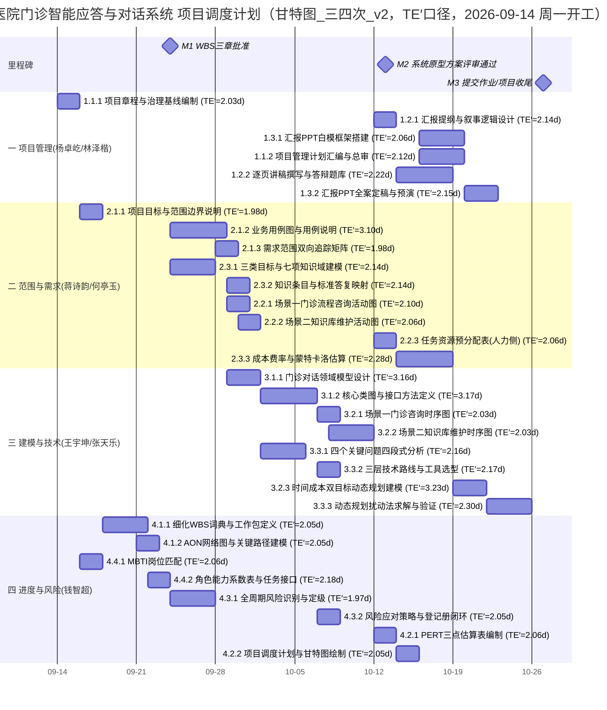

# 甘特图_三四次_v2 · Mermaid 源码

编制：钱智超（v2 修订 2026-10-26，WorkBuddy 代绘）。复制下方代码块到支持 Mermaid 的工具（WPS、飞书文档、Notion、Typora、mermaid.live）即可渲染。

## 与正式版 PNG 的差异说明
- 正式交付以《甘特图_三四次_v2.png》为准（含 Start/End 列、周末灰底、10-29 截止线、口径脚注）；
- Mermaid 不支持 SS+1d/FF+1d 搭接关系与工期限位标注，网络图六参数见《网络图_AON_v2.png》；
- 条长口径与 PNG 完全一致：TE′（引用詹少希《能力系数表_v1》引用台账第 2 条）。